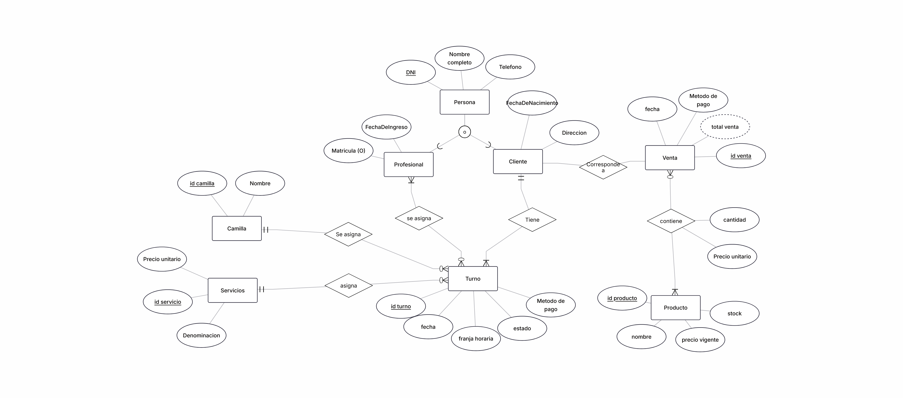
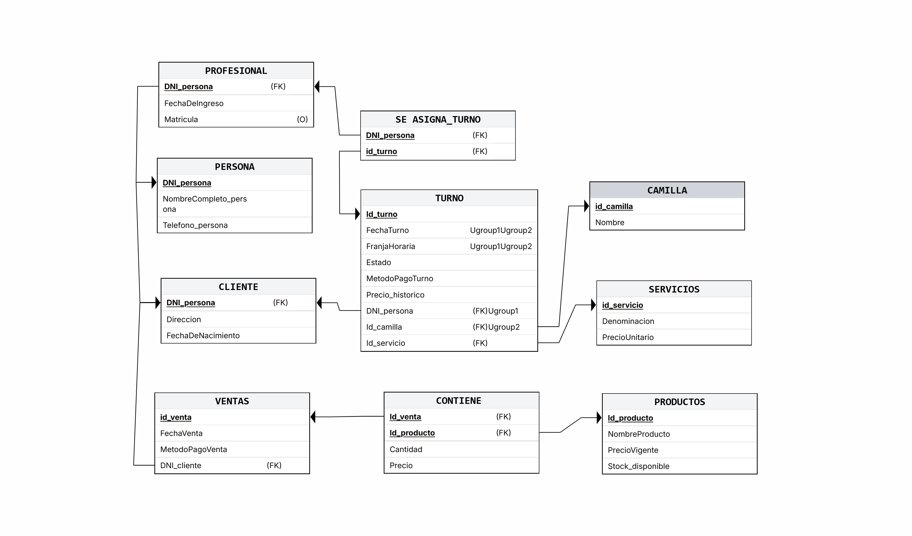
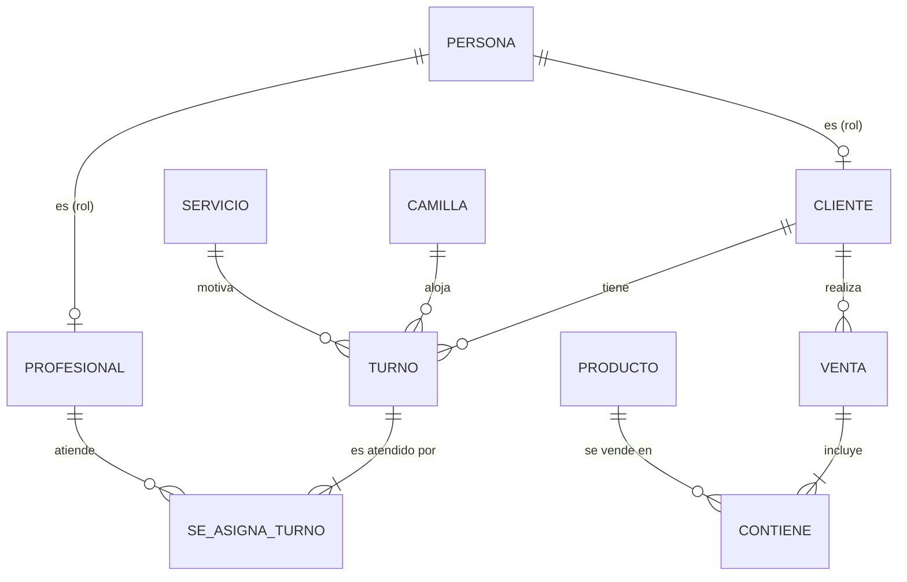
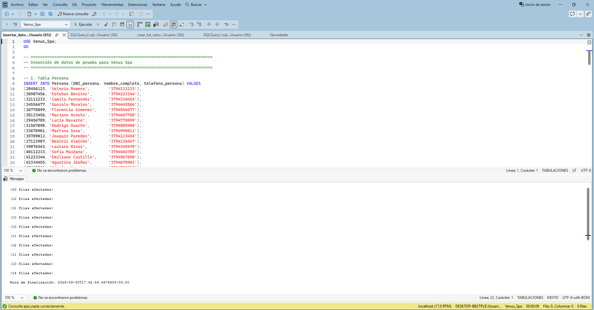

<div align="center">

# 💆‍♀️ Venus Spa
### Sistema de Gestión de Turnos, Servicios y Ventas

*Proyecto integrador de **Bases de Datos I** · Equipo 26*
*Lic. en Sistemas de Información · FaCENA · UNNE*


[📖 Descripción](#-descripción-del-caso) ·
[🧱 Modelo](#-modelo-de-datos) ·
[📏 Reglas](#-reglas-de-negocio) ·
[🚀 Instalación](#-cómo-ejecutarlo) ·
[🗂️ Estructura](#️-estructura-del-repositorio) ·
[🛣️ Etapas](#️-etapas-del-proyecto)

</div>

---

## 📖 Descripción del caso

**Venus Spa** es un centro de estética especializado en tratamientos faciales y capilares (PRP facial, PRP capilar, limpieza profunda, etc.). Este proyecto diseña e implementa la base de datos que le permite llevar el control informatizado de:

| | |
|---|---|
| 👥 **Personas** | Clientes y profesionales, con roles que pueden superponerse |
| 📅 **Turnos** | Con camilla, franja horaria, servicio, estado, pago y uno o más profesionales |
| 💅 **Servicios** | Catálogo de tratamientos con su precio vigente |
| 🧴 **Productos** | Catálogo de venta (cremas, shampoos, serums) con control de stock |
| 🛒 **Ventas** | Independientes de los turnos, con detalle y precio histórico por ítem |
| 🛏️ **Camillas** | Puestos de atención, ampliables a medida que el spa crece |

<details>
<summary>🚫 <b>Fuera del alcance</b></summary>

<br>

- Sueldos y liquidaciones del personal
- Control contable/impositivo completo (facturación electrónica AFIP)
- Gestión de proveedores y compras de mercadería
- Pagos mixtos o combinados
- Historia clínica detallada del paciente

</details>

📄 Más detalle en [`descripcion-caso.md`](docs/etapa-01/descripcion-caso.md) y [`alcance.md`](docs/etapa-01/alcance.md).

---

## 🧱 Modelo de datos

### Diagrama Entidad-Relación

<p align="center">
  
</p>

### Esquema relacional

<p align="center">
  
</p>

### Vista rápida de las relaciones



### Las 10 tablas

| Tabla | Clave primaria | Descripción |
|---|---|---|
| 🧍 `persona` | `dni_persona` | Datos comunes: nombre y teléfono |
| 👩‍⚕️ `profesional` | `dni_profesional` (FK) | Fecha de ingreso y matrícula *(opcional)* |
| 🙋 `cliente` | `dni_cliente` (FK) | Dirección y fecha de nacimiento |
| 🛏️ `camilla` | `id_camilla` | Puestos de atención |
| 💆 `servicio` | `id_servicio` | Denominación y precio vigente |
| 📅 `turno` | `id_turno` | Fecha, franja, estado, pago y precio histórico |
| 🔗 `se_asigna_turno` | `(dni_profesional, id_turno)` | N:M profesional ↔ turno |
| 🧾 `venta` | `id_venta` | Fecha, método de pago y cliente |
| 🧴 `producto` | `id_producto` | Nombre, precio vigente y stock |
| 🔗 `contiene` | `(id_venta, id_producto)` | Detalle de venta: cantidad y precio histórico |

> 📚 Esquema completo con tipos y claves: [`EsquemaRelacional_VenusSpa.md`](docs/etapa-02/EsquemaRelacional_VenusSpa.md)
> 🧮 Verificación 1FN / 2FN / 3FN: [`Normalizacion_VenusSpa.md`](docs/etapa-02/Normalizacion_VenusSpa.md)

### 🧠 Decisiones de diseño destacadas

- **Especialización parcial y superpuesta** de `persona` en `cliente` / `profesional`: una misma persona puede ser ambas cosas (RN.01).
- **Venta y Turno desacoplados**: evita ciclos de relaciones redundantes y valores nulos (RN.08).
- **Precios históricos** (`turno.precio_historico`, `contiene.precio`): congelan el valor al momento de la operación, así un cambio de precio de lista no altera ventas ya hechas.
- **Diseño directo en 3FN**: el paso del DER al relacional ya produce un esquema normalizado.

Ver [`decisiones-diseno.md`](docs/etapa-01/decisiones-diseno.md).

---

## 📏 Reglas de negocio

<details open>
<summary><b>Ver las reglas principales y cómo se implementan en el DDL</b></summary>

<br>

| Regla | Qué dice | Implementación |
|---|---|---|
| **RN.01** | Persona con DNI único; puede ser cliente, profesional o ambos | PK compartida + FK a `persona` |
| **RN.02 / 02.1** | Cupo por franja = cantidad de camillas; una camilla, un turno por horario | `UNIQUE (fecha, franja, camilla)` |
| **RN.03** | Un cliente no puede tener dos turnos en la misma franja | `UNIQUE (fecha, franja, cliente)` |
| **RN.04** | Stock descontado en cada venta; no se vende más de lo disponible | `CHECK (stock_disponible >= 0)` |
| **RN.05 / 05.1** | Precio histórico en el ítem de venta y en el turno | Columnas `precio` / `precio_historico` con `CHECK > 0` |
| **RN.06 / 06.1** | Un único método de pago: efectivo, débito, crédito o transferencia | `CHECK ... IN (...)` |
| **RN.07 / 07.1** | Un servicio por turno; uno o más profesionales | FK + tabla `se_asigna_turno` |
| **RN.08** | Ventas independientes de turnos | Sin relación directa entre ambas |
| **RN.09** | Estado: `pendiente`, `confirmado`, `realizado`, `cancelado` | `CHECK ... IN (...)` |
| **RN.10** | Matrícula opcional (y única si se informa) | `NULL` + índice único filtrado |
| **RN.11** | Turnos de 1 h, de 08–12 y 15–19 h | `CHECK` sobre `franja_horaria` |

</details>

📄 Lista completa en [`reglas-negocio.md`](docs/etapa-01/reglas-negocio.md).

---

## 🚀 Cómo ejecutarlo

### Requisitos

- 🗄️ **Microsoft SQL Server** (2016 o superior, por el uso de `DROP TABLE IF EXISTS`)
- 🖥️ **SQL Server Management Studio (SSMS)** o **Azure Data Studio**

### Pasos

**1️⃣ Crear la base y las tablas** (DDL)

```sql
-- Abrir y ejecutar completo:
sql/ddl/crear_bd_venus_spa.sql
```

**2️⃣ Cargar los datos de prueba** (DML)

```sql
-- Abrir y ejecutar completo:
sql/dml/insertar_datos_venus_spa.sql
```

**3️⃣ Verificar**

```sql
USE Venus_Spa;
SELECT * FROM turno;
SELECT * FROM venta;
```

**4️⃣ Scripts técnicos de la Etapa V** *(opcional, después del DDL y el DML)*

```sql
-- Abrir y ejecutar el script del tema que se quiera probar:
sql/tecnico/procedimientos_funciones.sql
```

> ⚠️ El script DDL **elimina y recrea** las tablas (`DROP TABLE IF EXISTS`), por lo que borra cualquier dato previo en `Venus_Spa`.
> ✅ Ejecutar siempre el **DDL antes que el DML**.

### Evidencia de ejecución

| DDL ejecutado sin errores | Base poblada |
|:---:|:---:|
|  |  |

---

## 🗂️ Estructura del repositorio

```text
proyecto-bd1-equipo-26/
├── 📁 docs/
│   ├── 📁 etapa-01/          # Relevamiento y análisis
│   │   ├── descripcion-caso.md
│   │   ├── alcance.md
│   │   ├── reglas-negocio.md
│   │   ├── decisiones-diseno.md
│   │   └── Etapa-01Informe.pdf
│   ├── 📁 etapa-02/          # Diseño lógico
│   │   ├── DER/              # DER (.png y .erdplus)
│   │   ├── EsquemaRelacional_VenusSpa.{md,png,erdplus}
│   │   └── Normalizacion_VenusSpa.md
│   ├── 📁 etapa-03/          # Implementación física
│   │   └── Resumen Etapa III.md
│   ├── 📁 etapa-04/          # Consultas y casos de uso
│   │   ├── casos-uso.md
│   │   ├── comprobante-venta.md
│   │   ├── informe-ventas.md
│   │   └── consulta-avanzada.md
│   └── 📁 etapa-05/          # Temas técnicos (por tema: investigacion.md y evidencias/)
│       ├── procedimientos_funciones/
│       ├── transacciones/
│       ├── triggers_auditoria/
│       ├── seguridad/
│       └── indices_optimizacion/
├── 📁 sql/
│   ├── 📁 ddl/               # crear_bd_venus_spa.sql
│   ├── 📁 dml/               # insertar_datos_venus_spa.sql
│   ├── 📁 consultas/
│   │   ├── comprobante_venta.sql
│   │   ├── informe_ventas.sql
│   │   └── consulta_avanzada.sql
│   └── 📁 tecnico/           # Scripts de la Etapa V
│       ├── procedimientos_funciones.sql
│       ├── transacciones.sql
│       ├── triggers_auditoria.sql
│       ├── seguridad.sql
│       └── indices_optimizacion.sql
└── README.md
```

---

## 🛣️ Etapas del proyecto

| Etapa | Contenido | Estado | Documentación |
|:---:|---|:---:|---|
| **I** | Relevamiento, alcance y reglas de negocio | ✅ Completa | [`docs/etapa-01`](docs/etapa-01/) |
| **II** | DER, esquema relacional y normalización | ✅ Completa | [`docs/etapa-02`](docs/etapa-02/) |
| **III** | Implementación física (DDL y DML) | ✅ Completa | [Resumen Etapa III](docs/etapa-03/Resumen%20Etapa%20III.md) |
| **IV** | Consultas y objetos técnicos | ✅ Completa | [`docs/etapa-04`](docs/etapa-04/) |
| **V** | Temas técnicos: procedimientos y funciones, transacciones, triggers de auditoría, seguridad e índices | 🚧 En curso | [`docs/etapa-05`](docs/etapa-05/) |

### 🔧 Etapa V: temas técnicos

Cada tema se documenta en `docs/etapa-05/<tema>/` (investigación y evidencias) y se implementa en `sql/tecnico/<tema>.sql`.

| Tema | Documentación | Script | Estado |
|---|---|---|---|
| Procedimientos y funciones almacenadas | [`docs/etapa-05/procedimientos_funciones`](docs/etapa-05/procedimientos_funciones/) | [`procedimientos_funciones.sql`](sql/tecnico/procedimientos_funciones.sql) | ✅ Completo |
| Manejo de transacciones | [`docs/etapa-05/transacciones`](docs/etapa-05/transacciones/) | [`transacciones.sql`](sql/tecnico/transacciones.sql) | ⏳ Pendiente |
| Triggers de auditoría | [`docs/etapa-05/triggers_auditoria`](docs/etapa-05/triggers_auditoria/) | [`triggers_auditoria.sql`](sql/tecnico/triggers_auditoria.sql) | ⏳ Pendiente |
| Seguridad | [`docs/etapa-05/seguridad`](docs/etapa-05/seguridad/) | [`seguridad.sql`](sql/tecnico/seguridad.sql) | ⏳ Pendiente |
| Índices (optimización) | [`docs/etapa-05/indices_optimizacion`](docs/etapa-05/indices_optimizacion/) | [`indices_optimizacion.sql`](sql/tecnico/indices_optimizacion.sql) | ⏳ Pendiente |

---

## 🛠️ Herramientas utilizadas


Los diagramas son editables abriendo los `.erdplus` en [erdplus.com](https://erdplus.com/).

---

## 👥 Equipo 26

| Integrante | DNI |
|---|---|
| 👩‍💻 Torres, Yleana Beatriz | 44.982.909 |
| 👩‍💻 Zacariaz Cañete, Ana Paula | 46.469.071 |
| 👩‍💻 Vallejos Romero, Josefina | 47.536.877 |
| 👨‍💻 Caraballo, Ivan Jeremias | 47.990.133 |
| 👨‍💻 Peloso, Jorge Gabriel | 43.751.960 |

---

<div align="center">

**Bases de Datos I** · Facultad de Ciencias Exactas y Naturales y Agrimensura · UNNE
Hecho con 💗 por el Equipo 26

</div>